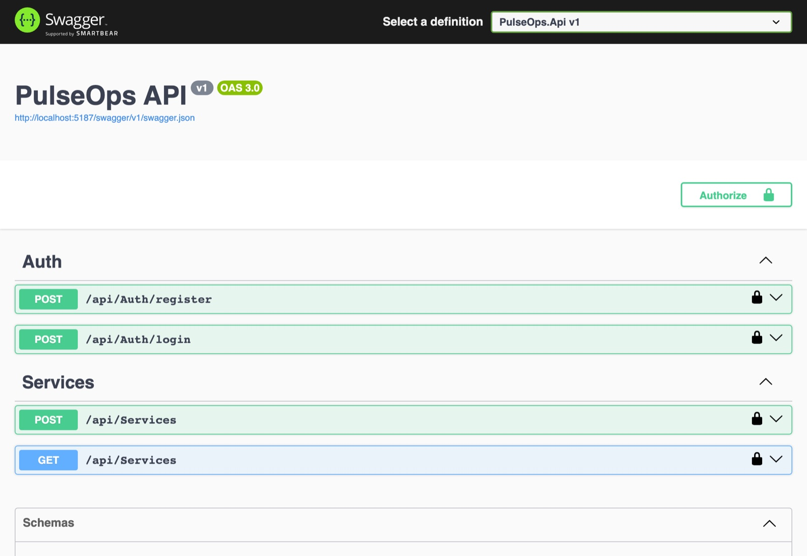
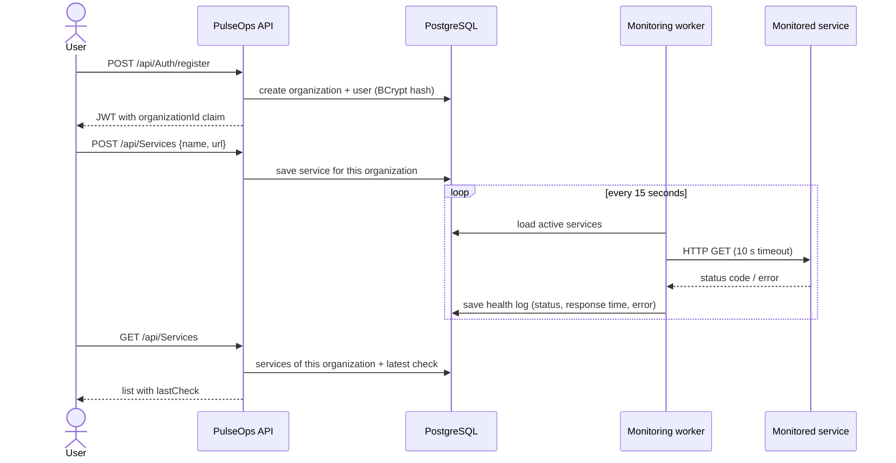
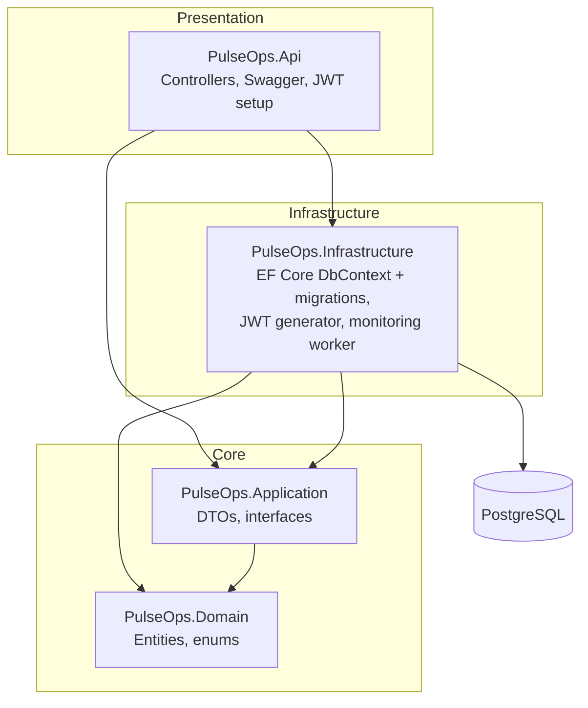

# PulseOps


**A service monitoring and health-check API.** An organization registers the websites and APIs it cares about, and a
background worker checks each of them over HTTP, recording the status code, response time and any error. Every user
belongs to an organization and only ever sees that organization's services (multi-tenant).



## Highlights

- **Clean Architecture in .NET 8:** four projects (Domain, Application, Infrastructure, Presentation) with
  dependencies pointing inwards, so the domain has no reference to EF Core or ASP.NET.
- **Multi-tenancy through the token:** the JWT carries an `organizationId` claim, and every query is filtered by it,
  so one organization can never read another's services.
- **Background worker:** an ASP.NET Core `BackgroundService` checks every active service every 15 seconds with a
  10-second timeout and stores each result as a health log.
- **Secure defaults:** BCrypt password hashing, and the JWT signing key comes from configuration; outside
  Development the API refuses to start without one.
- **Reproducible setup:** PostgreSQL (TimescaleDB image) in Docker Compose, schema managed by EF Core migrations,
  interactive docs in Swagger UI.

## How it works



### Example response

`GET /api/Services` after the worker has run, with three demo services: one healthy, one returning 503 and one
whose domain doesn't exist (IDs shortened).

```json
[
  {
    "id": "49b3b249-…",
    "name": "GitHub",
    "url": "https://github.com",
    "checkIntervalSeconds": 30,
    "isActive": true,
    "lastCheck": { "statusCode": 200, "isHealthy": true, "responseTimeMs": 798, "errorMessage": null }
  },
  {
    "id": "46e00890-…",
    "name": "Payments API (staging)",
    "url": "https://httpbin.org/status/503",
    "checkIntervalSeconds": 30,
    "isActive": true,
    "lastCheck": { "statusCode": 503, "isHealthy": false, "responseTimeMs": 550, "errorMessage": null }
  },
  {
    "id": "bebbf7d5-…",
    "name": "Legacy portal",
    "url": "https://legacy-portal.invalid",
    "checkIntervalSeconds": 60,
    "isActive": true,
    "lastCheck": {
      "statusCode": 0,
      "isHealthy": false,
      "responseTimeMs": 9,
      "errorMessage": "nodename nor servname provided, or not known (legacy-portal.invalid:443)"
    }
  }
]
```

## Architecture



### Domain model

- **Organization** – a tenant; owns users and monitored services
- **User** – belongs to one organization, with a BCrypt password hash and a role
- **MonitoredService** – name, URL, check interval and whether it is active
- **ServiceHealthLog** – one check: status code, healthy or not, response time in milliseconds, error message
- **AlertRule**, **MetricLog** – in place for alerting and metrics (see the roadmap)

## Tech stack

| Layer          | Technology |
|----------------|------------|
| API            | .NET 8, ASP.NET Core Web API |
| Architecture   | Clean Architecture: Domain, Application, Infrastructure, Presentation |
| Database       | PostgreSQL (TimescaleDB image), Entity Framework Core with migrations |
| Security       | JWT bearer authentication, BCrypt password hashing |
| Documentation  | Swagger / OpenAPI (Swashbuckle) |
| Infrastructure | Docker Compose |

## Project structure

```
src/
  Core/
    PulseOps.Domain/           Entities (Organization, User, MonitoredService, ServiceHealthLog…) and enums
    PulseOps.Application/      DTOs and interfaces, such as IJwtTokenGenerator
  Infrastructure/
    PulseOps.Infrastructure/   EF Core DbContext and migrations, JWT generator, monitoring worker
  Presentation/
    PulseOps.Api/              Controllers, Swagger, startup configuration
```

## API

| Method | Path | Description |
|--------|------|-------------|
| `POST` | `/api/Auth/register` | Create a user and their organization; returns a JWT |
| `POST` | `/api/Auth/login` | Log in; returns a JWT |
| `POST` | `/api/Services` | Register a service to monitor (requires a JWT) |
| `GET`  | `/api/Services` | Your organization's services with their latest check (requires a JWT) |

Example requests are in [`PulseOps.Api.http`](src/Presentation/PulseOps.Api/PulseOps.Api.http).

## Running locally

Requirements: .NET 8 SDK and Docker.

```bash
# 1. Start PostgreSQL (port 5434)
docker compose up -d pulseops-db

# 2. Create the database schema
dotnet tool install --global dotnet-ef   # once
dotnet ef database update --project src/Infrastructure/PulseOps.Infrastructure --startup-project src/Presentation/PulseOps.Api

# 3. Run the API
dotnet run --project src/Presentation/PulseOps.Api --launch-profile http
```

Swagger UI: http://localhost:5187/swagger. Use **Authorize** with `Bearer <token>` to call the protected endpoints.

## Configuration

Settings come from `appsettings.json` and can be overridden with environment variables. Secrets are never committed.

| Variable | Purpose |
|----------|---------|
| `JwtSettings__Secret` | Key that signs tokens, at least 32 bytes (`openssl rand -base64 32`). **Required outside Development.** In Development a random key is generated on each start, so tokens stop working after a restart. |
| `ConnectionStrings__DefaultConnection` | PostgreSQL connection. Defaults to the Docker Compose database on port 5434. |
| `JwtSettings__ExpiryMinutes` | Token lifetime, 120 minutes by default. |

## Roadmap

- Respect each service's own check interval, and check services in parallel
- Alert rules (slow responses, consecutive failures) with email notifications; the `AlertRule` entity is in place
- Refresh tokens
- Uptime and latency history endpoints backed by TimescaleDB
- Tests and a CI pipeline
